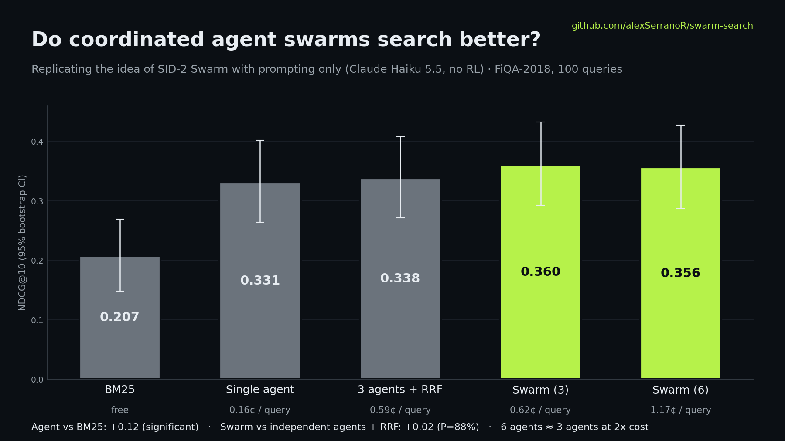
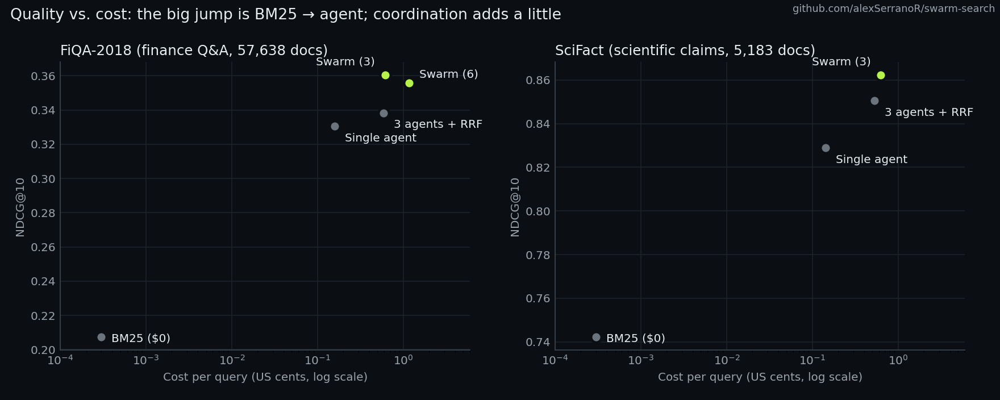
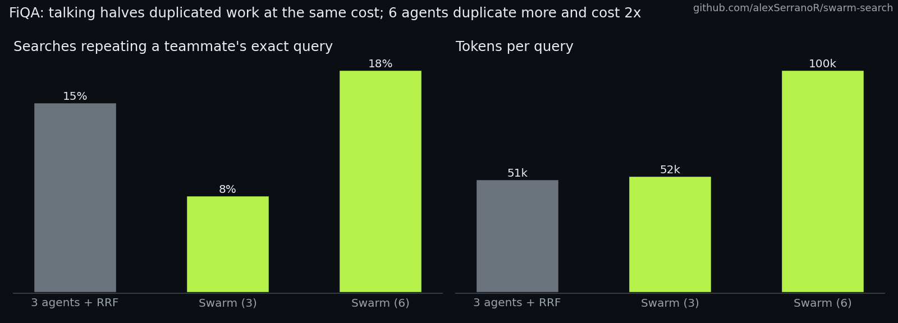
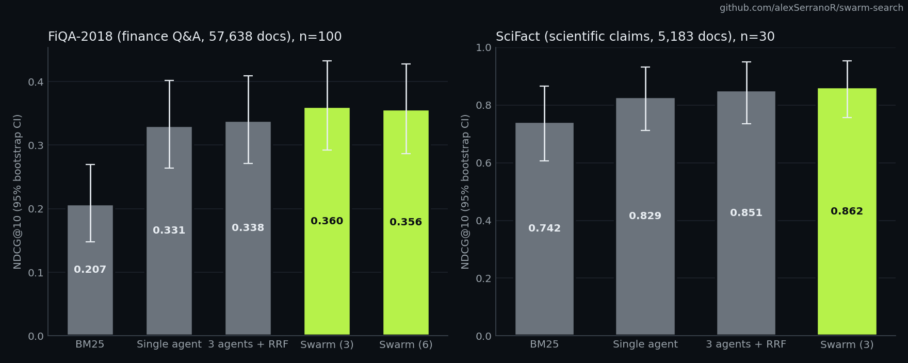

<h1 align="center">swarm-search</h1>

<p align="center">
  <b>Do coordinated agent swarms search better than independent agents?</b><br>
  A small, reproducible test of the idea behind <a href="https://www.sid.ai/research/sid-2-technical-report">SID-2 Swarm</a>,
  with prompting only (no RL) and about $3 of API calls.
</p>

<p align="center">
  <a href="https://github.com/alexSerranoR/swarm-search/actions/workflows/tests.yml"></a>
  
  
  
</p>

<p align="center">
  
</p>

## TL;DR

The [SID-2 technical report](https://www.sid.ai/research/sid-2-technical-report) argues that, for search,
**adding coordinated agents beats both fusing independent runs and using bigger models**, and trains its
swarms with multi-agent RL. I wanted to know how much of that holds **without any training**: an
off-the-shelf small model (Claude Haiku 5.5), a hand-written tool loop, and a shared message board.

On **FiQA-2018** (finance Q&A, 57,638 documents, 100 queries) and **SciFact** (scientific claims):

1. **The big win is having an agent at all.** A single search agent beats BM25 by **+0.12 NDCG@10 on FiQA
   (+60% relative, 95% CI [+0.06, +0.19])** for 0.16¢ per query.
2. **Coordination helps a little, consistently, but not significantly.** A 3-agent swarm beats 3 independent
   agents fused with RRF by **+0.022 on FiQA (P(Δ>0) = 88%)** and +0.012 on SciFact. Same direction on both datasets.
3. **Talking is almost free on the harder corpus.** On FiQA the swarm halves duplicated searches
   (8% vs 15%) at the same token cost as independent agents (52k vs 51k tokens/query).
4. **Scaling from 3 to 6 agents does not help without training.** Same NDCG (−0.004), 2× the cost, and
   duplicated searches go back up to 18%. In SID-2, swarms keep improving up to 12 agents; the difference
   is most likely the RL.
5. **Prompted agents do not coordinate by default.** In the first version, agents messaged only right
   before finishing and ran identical queries. They only coordinated once the harness *required* an early
   message announcing their angle (see [Swarm v1 → v2](#swarm-v1--v2-agents-dont-coordinate-by-default)).

> **Bottom line:** the architecture alone gets you a small, cheap gain. The scaling behavior reported for
> SID-2 Swarm looks like it comes from training agents to coordinate, not just from letting them talk.

## Setup

Every method uses the same BM25 index, the same model (`claude-haiku-5-5`), the same tool loop and the
same turn limit (8 turns per agent). Rankings are evaluated at k = 10.

| Method | What it does |
|---|---|
| **BM25** | Classic keyword retrieval (`rank-bm25`). No LLM. |
| **Single agent** | One LLM agent with `search` (BM25 + snippets), `read_doc` and `report_ids` tools. It reformulates and searches iteratively, then reports a ranked list. |
| **3 agents + RRF** | Three single agents run independently in parallel; their rankings are fused with Reciprocal Rank Fusion. This is the SID-2 baseline. |
| **Swarm (N)** | N agents run in parallel with an extra `message` tool (broadcast to a shared board). Teammates' messages are appended to each agent's next tool result. Rankings are fused with RRF. |

The only difference between *3 agents + RRF* and *Swarm (3)* is **communication**. Both get the same
diversity hint: agent 1 starts from the literal query and the others favor alternative wordings.

The harness borrows several ideas from the SID-2 report: snippets instead of full documents in search
results, "already seen" markers instead of repeating text, parallel tool calls within a turn, and RRF fusion
of the agents' reports.

## Methodology

- **Data.** BEIR versions of [FiQA-2018](https://sites.google.com/view/fiqa/) (57,638 forum answers, test
  split, first 100 queries) and SciFact (5,183 abstracts, test split, first 30–50 queries).
- **Metrics.** NDCG@10 (linear gain, log2 discount) and Recall@10, implemented in `evals/metrics.py` and
  covered by hand-computed tests.
- **Statistics.** Every comparison is **paired** on the same queries. 95% CIs and P(Δ > 0) come from a
  10,000-resample bootstrap over per-query differences (`analysis/make_report.py`, fixed seed).
- **Cost.** Computed from the token counts returned by the API at Claude Haiku 5.5 list prices
  ($0.10/M input, $0.50/M output; every call stays under the 100k-token tier). Latency is wall-clock
  on a laptop, including the BM25 calls.
- **Budget parity.** *3 agents + RRF* and *Swarm (3)* use the same number of agents, model, turn cap and
  per-agent diversity hint. The swarm only adds the `message` tool and the inbox.
- **Agent loop.** Up to 8 model turns per agent. All tool calls in a turn run before the next model
  call. Search results show the 10 best BM25 hits as 60-word snippets. Documents an agent has already
  seen are collapsed to an "already seen" line.

## Results

Full tables with paired bootstrap CIs are in **[`docs/results.md`](docs/results.md)**; it is regenerated by
`python analysis/make_report.py`.

### FiQA-2018: 100 queries

| Method | NDCG@10 | Recall@10 | Latency | Cost / query | Duplicated searches |
|---|---|---|---|---|---|
| BM25 | 0.207 | 0.253 | 0.2 s | free | — |
| Single agent | 0.331 | 0.392 | 4.6 s | 0.16¢ | — |
| 3 agents + RRF | 0.338 | 0.433 | 6.3 s | 0.59¢ | 15% |
| **Swarm (3)** | **0.360** | **0.465** | 7.6 s | 0.62¢ | **8%** |
| Swarm (6) | 0.356 | 0.455 | 10.0 s | 1.17¢ | 18% |

| Paired comparison | Δ NDCG@10 | 95% CI | P(Δ > 0) |
|---|---|---|---|
| Single agent vs BM25 | **+0.123** | [+0.060, +0.188] | 100% |
| 3 agents + RRF vs single agent | +0.008 | [−0.027, +0.041] | 67% |
| Swarm (3) vs 3 agents + RRF | +0.022 | [−0.015, +0.059] | 88% |
| Swarm (6) vs swarm (3) | −0.004 | [−0.037, +0.026] | 40% |

<p align="center"></p>
<p align="center"></p>

### SciFact: 30 queries

| Method | NDCG@10 | Recall@10 | Cost / query |
|---|---|---|---|
| BM25 | 0.742 | 0.857 | free |
| Single agent | 0.829 | 0.910 | 0.14¢ |
| 3 agents + RRF | 0.851 | 0.910 | 0.53¢ |
| **Swarm (3)** | **0.862** | **0.943** | 0.63¢ |

SciFact is close to a ceiling: BM25 already does well and the multi-agent methods tie on 25 of 30
queries, so it can hardly separate good strategies. That is why the main experiment moved to FiQA, where
BM25 scores ~0.2.

<p align="center"></p>

### Swarm v1 → v2: agents don't coordinate by default

The first swarm prompt only *allowed* messaging. In practice, the three agents launched **identical first
queries** and sent messages **only right before reporting**, when nobody could use them. That is roughly
the collapse into "independent agents + RRF" that the SID-2 report describes for its early RL runs, here
without any training at all.

v2 changes the harness, not the model: each agent must announce its angle in its first turn, share
promising IDs, and never repeat a teammate's query. On the same 3 SciFact queries, messages went from 1.7
to 4.3 per query (now from turn 1), searches from 17.3 to 14.7, and tokens dropped by about 27%, with the same NDCG.

## Limitations

- **Prompting, not RL.** SID-2's agents are trained to coordinate; these are not. This tests the
  architecture, not the training recipe.
- **Small samples.** 100 FiQA queries and 30 SciFact queries. The swarm-vs-RRF gap is within the CIs on
  both datasets; only the agent-vs-BM25 gap is clearly significant.
- **Simplified swarm.** No `fork` / `wait`, N fixed agents, and broadcast messages instead of 1-to-1 ones.
- **Padding.** When an agent reports fewer than 10 IDs, the ranking is padded with BM25 results for the
  original query (about 0.6 docs per query for multi-agent methods, 2.9 for the single agent on FiQA).
- **Incomplete labels.** On FiQA, 23 of 100 queries score 0 for every method; many valid answers are
  simply not labeled as relevant.
- **Exact-match duplicates.** The duplicate-query metric only counts identical query strings. Agents still
  overlap semantically.
- **Run-to-run variance.** LLM agents are not deterministic. The same query can score differently across runs.

## Reproduce

```bash
python -m venv .venv
source .venv/bin/activate              # Windows: .venv\Scripts\activate
pip install -r requirements.txt
export ANTHROPIC_API_KEY=sk-ant-...    # Windows PowerShell: $env:ANTHROPIC_API_KEY="sk-ant-..."

python data/download.py fiqa
python evals/run_eval.py --dataset fiqa --retriever bm25  --limit 100
python evals/run_eval.py --dataset fiqa --retriever agent --limit 5 --verbose   # smoke test
python evals/run_eval.py --dataset fiqa --retriever agent --limit 100
python evals/run_eval.py --dataset fiqa --retriever rrf_n --limit 100
python evals/run_eval.py --dataset fiqa --retriever swarm --limit 100
python evals/run_eval.py --dataset fiqa --retriever swarm --agents 6 --limit 100

python analysis/make_report.py   # tables + figures
pytest -q                        # metric and RRF tests
```

The full FiQA experiment costs about **$2.50** with Claude Haiku 5.5. The raw per-query results, including
every agent's queries, the message board and token counts, are in [`results/`](results).

## Project structure

```
agents/search_agent.py     single agent: the hand-written tool loop (run_episode)
agents/swarm.py            3 agents + RRF baseline, and the swarm with a shared message board
retrievers/bm25_retriever.py   BM25 + snippet extraction (the agents' search tool)
retrievers/rrf.py          Reciprocal Rank Fusion
evals/metrics.py           recall@k, NDCG@k
evals/run_eval.py          runs a method over a dataset and saves per-query results
analysis/make_report.py    paired bootstrap CIs, tables and figures
data/                      BEIR download and loading
tests/                     hand-computed tests for the metrics and RRF
```

## References

- SID Research, *SID-2 Technical Report: Scaling Search Swarms* (2026). https://www.sid.ai/research/sid-2-technical-report
- Thakur et al., *BEIR: A Heterogeneous Benchmark for Zero-shot Evaluation of Information Retrieval Models* (2021), for the SciFact and FiQA-2018 data.
- Cormack, Clarke & Büttcher, *Reciprocal Rank Fusion outperforms Condorcet and individual Rank Learning Methods* (SIGIR 2009).

## Author

**Alejandro Serrano Ruibal** · [Portfolio](https://alex-portfolio-eight-pi.vercel.app) · [LinkedIn](https://www.linkedin.com/in/alejandro-serrano-ruibal) · [X](https://x.com/AlexSer22436070)

Not affiliated with SID. MIT licensed.
